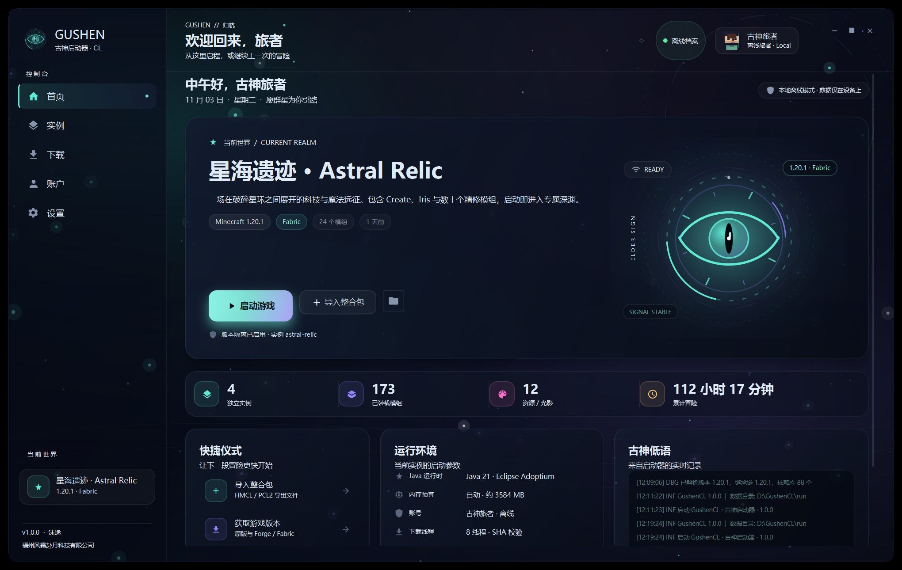
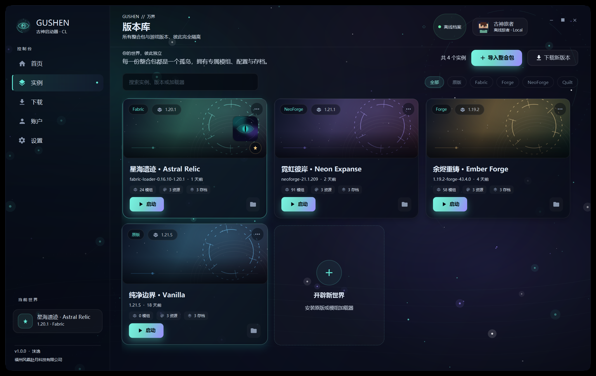
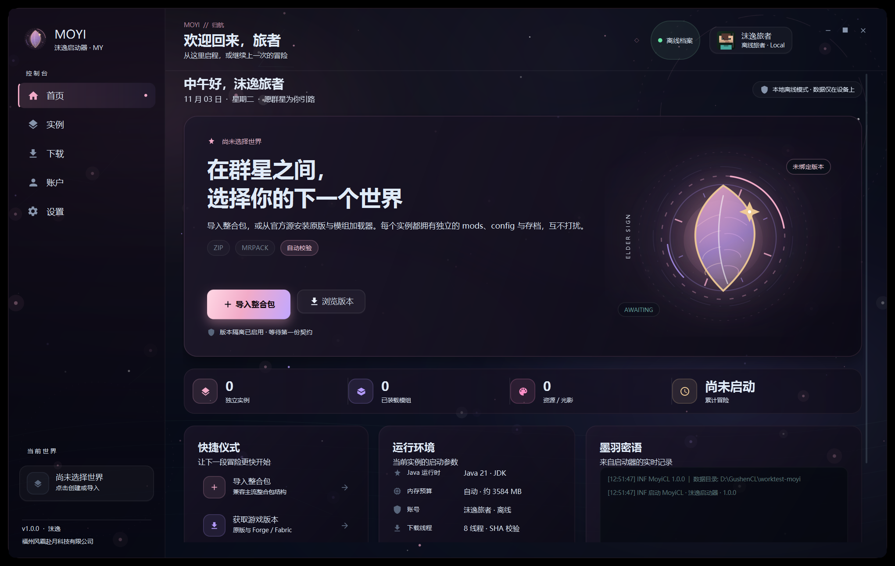
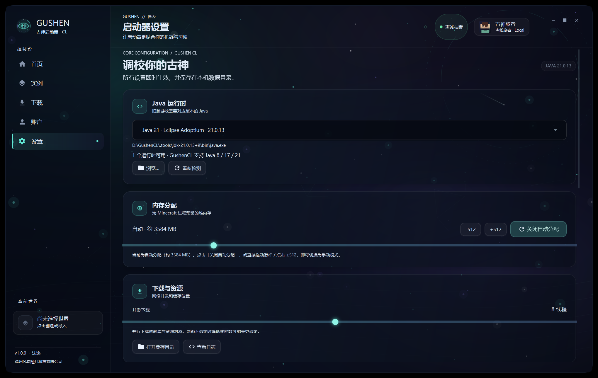
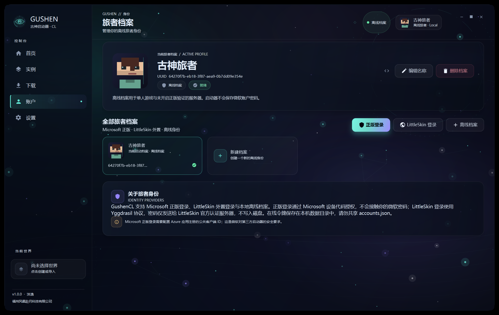
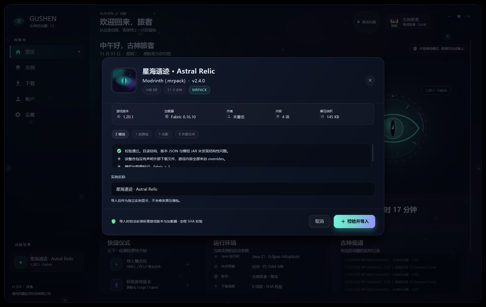

# GushenCL · 古神启动器 / MoyiCL · 沫逸启动器

> 独立、非官方的 Minecraft: Java Edition 桌面启动器。  
> 作者：**沫逸**　·　所属公司：**福州风霜赴月科技有限公司**

GushenCL 与 MoyiCL 使用同一套启动器引擎，分别采用「星海古神」与「墨羽沫逸」两套视觉皮肤。项目专注于多实例隔离、整合包导入、模组加载器安装、正版 / 外置登录，以及精致流畅的桌面体验。

> 本仓库是项目的公开信息页与审核资料页。启动器源码和可执行文件为专有软件，不在此仓库公开分发。



## 功能概览

- **多实例隔离**：每个实例拥有独立 `mods`、`config`、`saves`、`resourcepacks`、`shaderpacks`，共享版本与资源库。
- **整合包导入**：自动识别多种主流整合包结构，校验路径、版本 JSON、模组 JAR、配置与资源包，并在导入前展示完整报告。
- **加载器安装**：支持 Mojang 原版、Fabric、Quilt、Forge、NeoForge。
- **Microsoft 正版登录**：使用官方 OAuth 2.0 设备代码流，不接触微软密码。
- **LittleSkin 外置登录**：Yggdrasil 认证，启动时自动加载 authlib-injector。
- **内容源**：Modrinth、CurseForge（MCIM 中文镜像）、MC百科中文条目。
- **界面**：JavaFX 自绘星空 / 星云、程序化实例封面、矢量图标、玻璃拟态卡片与动效。

## 界面

| GushenCL | MoyiCL |
| --- | --- |
|  |  |

| 资源库 | 设置 |
| --- | --- |
|  |  |

| 旅者档案 | 导入校验 |
| --- | --- |
|  |  |

## 身份验证与安全

Microsoft 登录使用 Microsoft identity platform 官方 OAuth 2.0 **Device Code Flow**，请求的 scope 仅为：

```text
XboxLive.signin offline_access
```

授权后按标准流程完成 Xbox Live、XSTS 和 Minecraft Services 登录，仅用于验证用户本人已拥有的 Minecraft: Java Edition，并获取启动档案。启动器：

- 不收集、不保存 Microsoft 密码；
- 不包含服务端账户数据库；
- 不向开发者或第三方传输访问令牌；
- 只在本机 `accounts.json` 保存令牌；
- 不包含、不分发 Minecraft 游戏资源。

详细说明：[AUTHENTICATION.md](AUTHENTICATION.md)  
隐私说明：[PRIVACY.md](PRIVACY.md)  
安全说明：[SECURITY.md](SECURITY.md)

## 关于 Client ID

Microsoft 登录需要启动器自己的 Azure 应用公共客户端 ID。Minecraft Services 对新客户端 ID 有独立的审核 / 白名单流程；未通过时，登录最后一步会返回：

```text
HTTP 403 Invalid app registration
```

应用审核配置与公开资料见：

- [Azure OAuth 配置教程](docs/azure-oauth.md)
- [身份验证与安全说明](AUTHENTICATION.md)

> 本仓库只用于项目介绍与审核资料展示，不包含可执行文件、账号数据或私密令牌。

## 版权

Copyright © 2026 福州风霜赴月科技有限公司. All rights reserved.

GushenCL / MoyiCL 是非官方 Minecraft 启动器，与 Mojang Studios、Microsoft、LittleSkin 及任何模组平台均无隶属关系。Minecraft 是 Microsoft 的商标。启动器不内置游戏本体，所有游戏资源均由官方渠道下载。

第三方依赖声明见 [NOTICE.md](NOTICE.md)。
